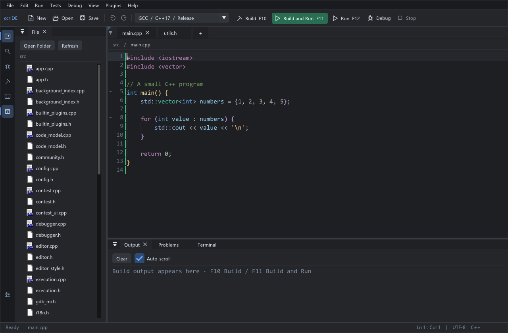
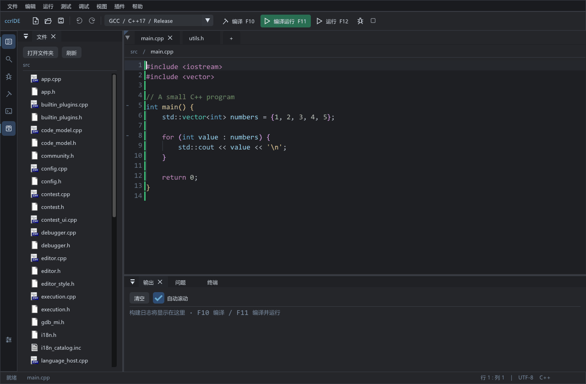

# ccrIDE

[简体中文](README.md) | **English**

A lightweight C++ IDE for **Windows x64**, focused on fast, single-file and competitive-programming workflows. Built with Dear ImGui, GLFW and OpenGL. Current version: **0.3.7.2**. The original prototype is preserved in `IDE.py`.

[Download installer](https://github.com/yunyugong/ccrIDE/releases/download/v0.3.7.2/ccrIDE-Setup-v0.3.7.2.exe) · [Download portable bundle](https://github.com/yunyugong/ccrIDE/releases/download/v0.3.7.2/ccrIDE-v0.3.7.2-win64-with-GCC.zip) · [Plugin API](docs/plugin-api.md)

The development branch is preparing **v0.3.8** with background search/header models, cancellable downloads and toolbar labels. See [implementation notes](docs/responsiveness-0.3.8.md). Download links below still point to the published stable release.

Compare the Chinese and English interfaces

This GIF is a slideshow of two actual v0.3.7.2 interface screenshots, rather than a recording of mouse actions. Switching languages preserves docked panel positions.

## Download and install

Get release packages from [GitHub Releases](https://github.com/yunyugong/ccrIDE/releases).

- `ccrIDE-Setup-v0.3.7.2.exe`: native offline installer with a selectable installation directory.
- `ccrIDE-v0.3.7.2-win64-with-GCC.zip`: portable bundle; extract the entire folder, then run `ccrIDE-v0.3.7.2.exe`.
- Both include GCC 11.5 and GDB. Keep the whole directory together; settings are in `data/`, plugins in `plugins/`, and the compiler in `toolchain/mingw64/`.
- Install into a **new, writable folder** when upgrading to preserve your previous version/settings. OpenGL 3.3 is required. English UI works without Chinese fonts; displaying Chinese source text still needs a suitable font.
- Matching `.sha256` files accompany the downloads. GitHub's automatically generated source archives do not include the compiler or a prebuilt application.

## Language and customization

Choose **Settings > Appearance and Colors > Language**, then System Default, Simplified Chinese or English. Changes apply immediately; click **Save Settings** to keep them. System Default uses Chinese on Chinese Windows and English otherwise. The installer has its own language selector.

Version 0.3.7.2 adds English localization, GitHub-hosted marketplace ZIP downloads, community link configuration and the public plugin API reference. It retains the 25 customization options introduced in 0.3.7.1: indentation, automatic completion, popup dimensions, line spacing/numbers, highlighting, change markers, caret blinking, interface font size/density/rounding, panel scrollbars, toolbar/status/activity visibility and recovery intervals. Preferences can be searched, imported/exported, reset, or set using compact/reading presets.

## Main workflows

| Action | Default shortcut |
| --- | --- |
| Build | F10 |
| Build and run | F11 |
| Run last successful build | F12 |
| Start / continue debugging | F5 |
| Save / Save As | Ctrl+S / Ctrl+Shift+S |
| Find / completion | Ctrl+F / Ctrl+Space |
| Go to definition | Ctrl+B or Ctrl+click |
| Toggle breakpoint | Ctrl+click a line number |

Enter program input in Terminal; Enter sends it to stdin. Stop cancels a build/run. GDB provides basic breakpoints, stepping, locals, call stacks and expression evaluation. The Tests menu provides cases, Subtasks and generator/reference stress tests. Alt+click adds carets; Alt+Shift+drag selects columns.

Files, editor and bottom Problems/Output/Terminal/Debug panels support dragging, splitting, floating and docking. Visible window titles may change language without resetting their IDs/layouts. File icons use Windows file associations. Red change markers mean new/modified lines since save; green means original/saved lines.

Recovery snapshots cover open tabs and restore copies without overwriting original files. They are not a substitute for saved files or version control. Managed tasks have separate IDs/work/temp directories and resource limits; Task Manager lets you inspect and cancel them. Current shared per-user/logon-session limits are 2 foreground, 1 background and 2 service root tasks.

## Optional plugins

Install ZIPs through **Plugins > Install Local Plugin**, or refresh the online Plugin Marketplace. Uninstall an older plugin before installing a replacement. Ordinary lightweight completion stays in the core.

| Package | Purpose |
| --- | --- |
| `ai-assistant-v1.2.1.zip` | AI Assistant using your OpenAI-compatible endpoint; configure your own endpoint/key/model. |
| `completion-docs-v1.0.1.zip` | Full completion comments, declaration sources, multiple-header selection and clickable links. |
| `clangd-v1.2.1.zip` | Compiler-based C++ completion, diagnostics, definition and rename; offline package includes clangd 23.1.0. |

Updated packages follow the host language. Older compatible plugin binaries still load, but retain their original UI language. Source comments, user code and external tool messages are preserved, rather than machine-translated.

## Community and development

- [Plugin API reference](docs/plugin-api.md): lifecycle, ABI, callbacks, language services and localization.
- [GitHub hosting and JSON configuration](docs/community.md): community links, catalogs, release packages and translation contributions.
- [Contributing](CONTRIBUTING.md).
- [Build instructions](docs/building.en.md).

The core uses a lightweight C++ model. Complex templates are better served by the optional clangd plugin. Advanced debugging, large-project management and broad test-framework integration remain incomplete. External native DLL plugins run in the IDE process; independent AI/clangd workers do not turn the DLL API into a security sandbox.

Report issues with your version, Windows/compiler versions, language setting, reproduction steps and a small source example. Remove keys, private prompts and sensitive paths before sharing logs.
